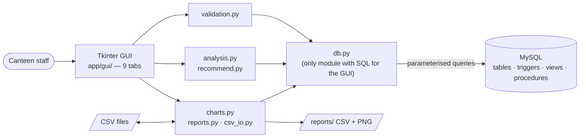
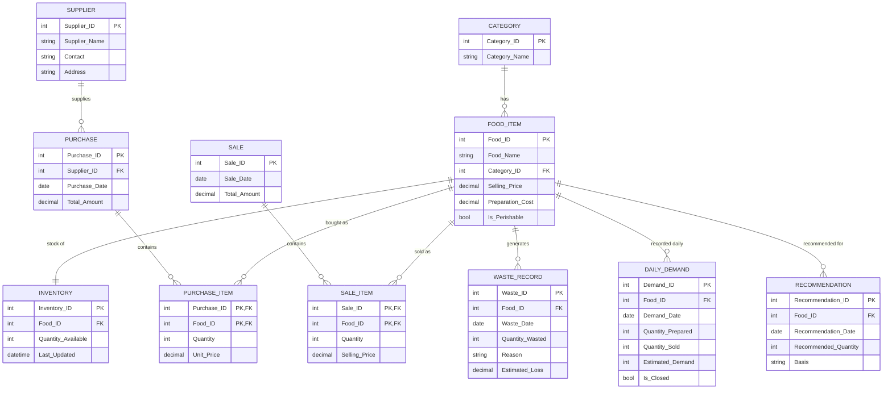
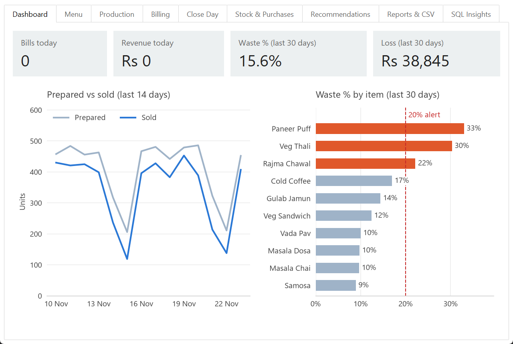
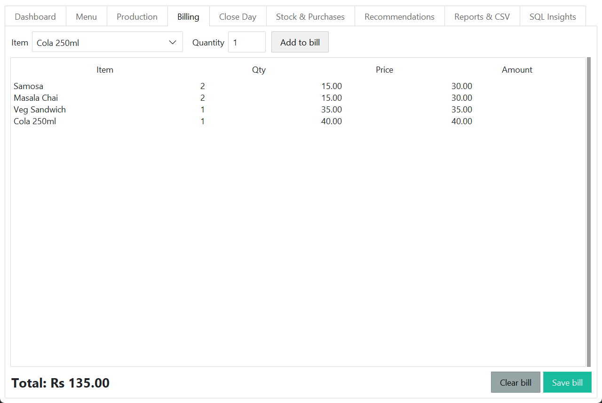
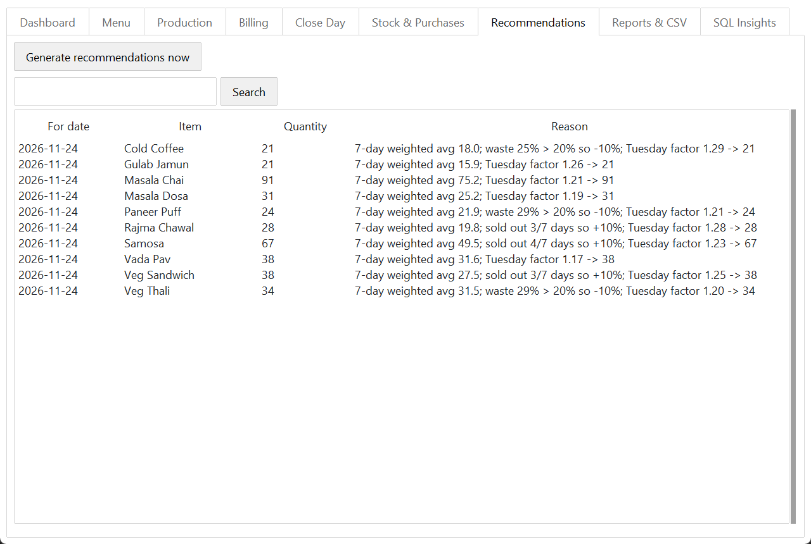
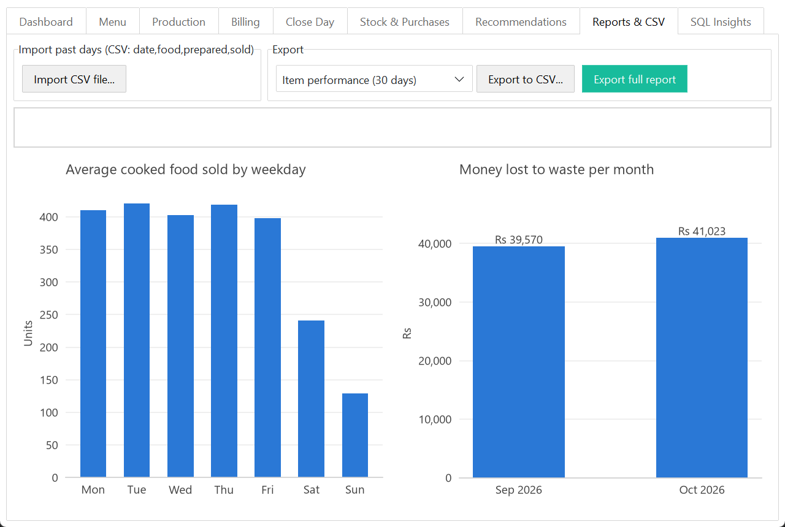
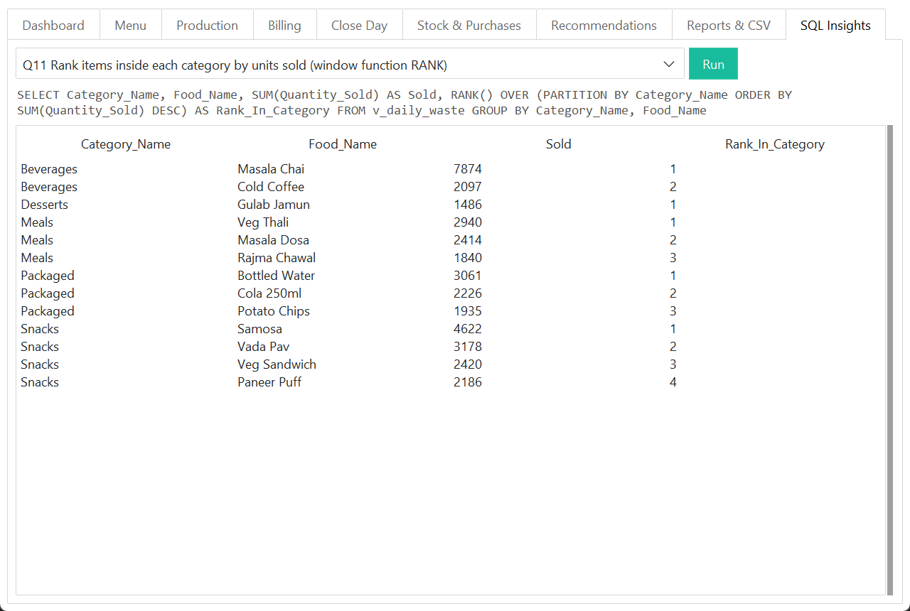

# Canteen Food Demand & Waste Tracker

A desktop app for a college canteen that records how much food is cooked and sold each day,
finds which items are wasted or sell out, estimates the money lost, and recommends how much
to cook tomorrow.

Built as one project for two 3rd-semester labs:
**DBMS Lab** (*Smart Canteen Management & Food Waste Reduction System*) and
**Python Lab** (*Canteen Food Demand & Waste Tracker*).

## Features

- **Menu management**: add, edit and delete food items and their price and cost.
- **Daily production**: enter what was cooked each morning, pre-filled from recommendations.
- **Billing**: build a bill line by line. The database blocks sales when stock runs out.
- **Close day**: one click records sales, turns cooked leftovers into waste records, and makes tomorrow's recommendations.
- **Waste analysis**: waste %, unsold quantity, money lost, popular and low-demand items, and alerts for items wasting over 20%.
- **Recommendations**: rule-based and explainable, with the reason stored for each item.
- **Stock & purchases**: stock levels, low-stock warning, suppliers, purchase entry.
- **CSV import & export**: import past days (bad rows are skipped and reported), export any report, or export a full report of CSVs and chart PNGs.
- **Dashboard**: 4 KPI cards and 2 charts (prepared vs sold, waste % by item). The Reports tab shows 2 more (sales by weekday, monthly loss).
- **SQL Insights**: run any of the 20 analytical queries from inside the app.

## Tech stack

| Part | Tools |
|---|---|
| Database | MySQL 8: constraints, 7 triggers, 5 views, 2 stored procedures |
| App | Python 3, Tkinter + ttkbootstrap |
| Database access | mysql-connector-python (parameterised queries only) |
| Analysis & charts | pandas, numpy, matplotlib, seaborn |
| Files | Python `csv` module |
| Tests | pytest |

Core Python concepts are written by hand: merge sort and binary search (used for table sorting
and search), a 2D list items × days demand matrix, lists and dictionaries for the analysis, and
input validation with exceptions.

## Architecture



**Daily workflow:** Production (morning) → Billing (day) → Close Day (evening: `sp_close_day` + next-day recommendations).

## ER diagram



`PURCHASE_ITEM` and `SALE_ITEM` have composite primary keys and resolve the many-to-many
relationships between purchases/sales and food items.

## Setup

You need Python 3.11+ and MySQL 8 or newer.

```powershell
git clone https://github.com/niha72019/Canteen-Food-Demand-Waste-Tracker.git
cd Canteen-Food-Demand-Waste-Tracker
py -m venv venv
.\venv\Scripts\Activate.ps1
pip install -r requirements.txt
copy .env.example .env        # then put your MySQL password in .env
```

Create the database and fill it with 90 days of sample data:

```powershell
python -m database.setup_db         # type YES (drops and recreates the database)
python -m database.generate_data    # about 1 minute
```

## Run

```powershell
python main.py
```

Run the tests:

```powershell
python -m pytest
```

A sample file for the CSV import is in `database/sample_import.csv`. It includes a few bad
rows on purpose, to show how they are reported.

## Screenshots

**Dashboard**: 4 KPIs, prepared vs sold, and waste % by item (items over the 20% alert in orange)


**Billing**


**Recommendations**: quantity for tomorrow and the reason for each


**Reports & CSV**: CSV import/export, sales by weekday and monthly loss


**SQL Insights**: analytical queries run from the app (here: `RANK()` window function)


## Project structure

```
app/            Python application: db access, validation, analysis, recommendations,
                CSV import/export, charts, reports
app/gui/        one file per tab + main window
database/       schema, triggers, views, procedures, analytical queries,
                setup and sample-data scripts, sample CSV
tests/          pytest tests (database, analysis, algorithms, validation, recommendations)
main.py         starts the app
```
